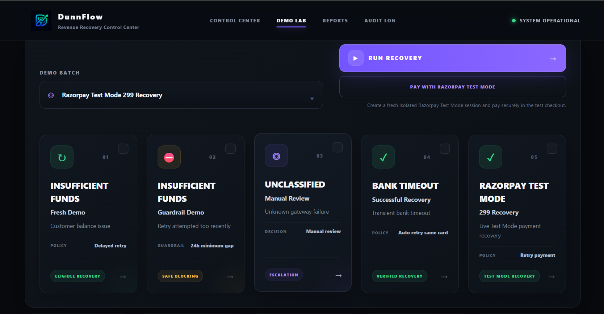
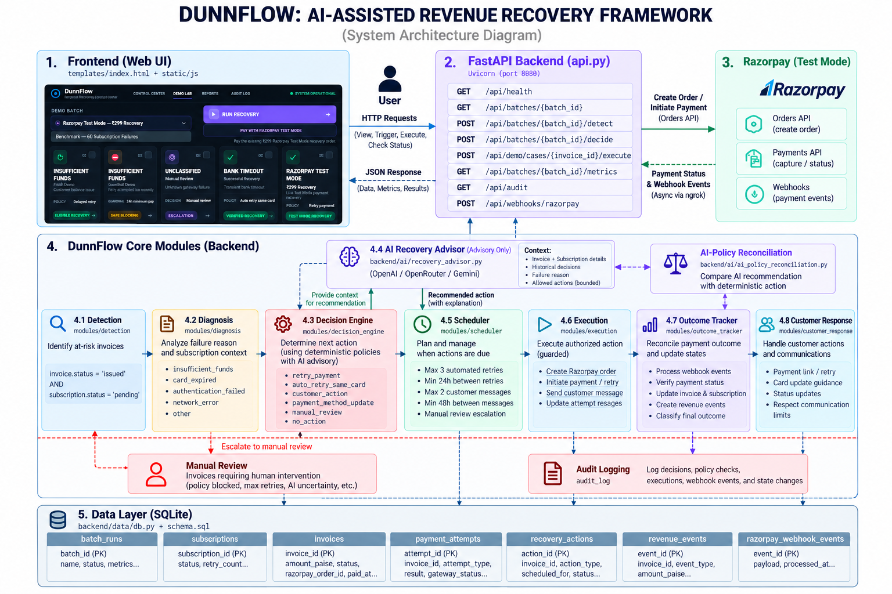
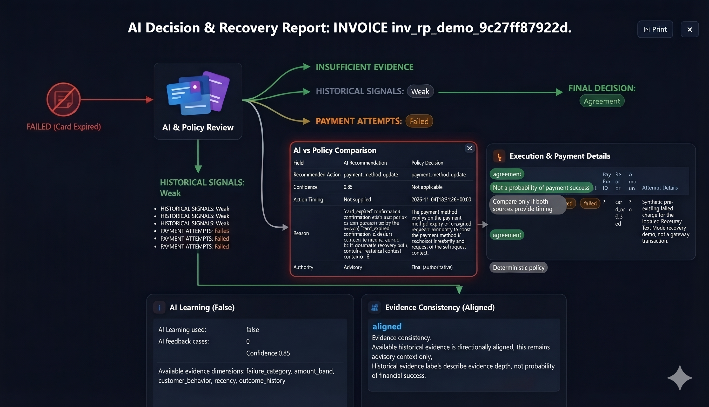
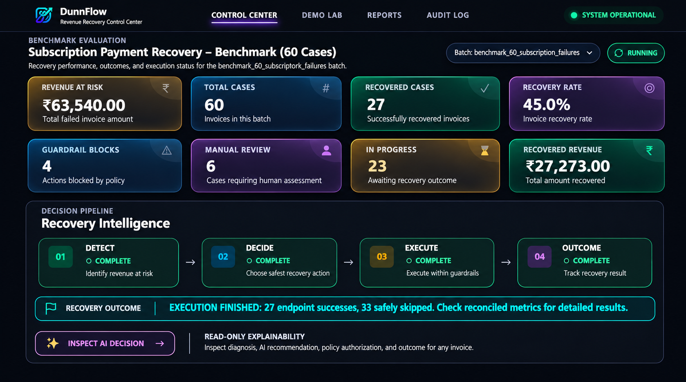
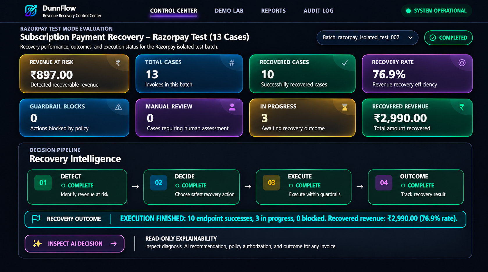
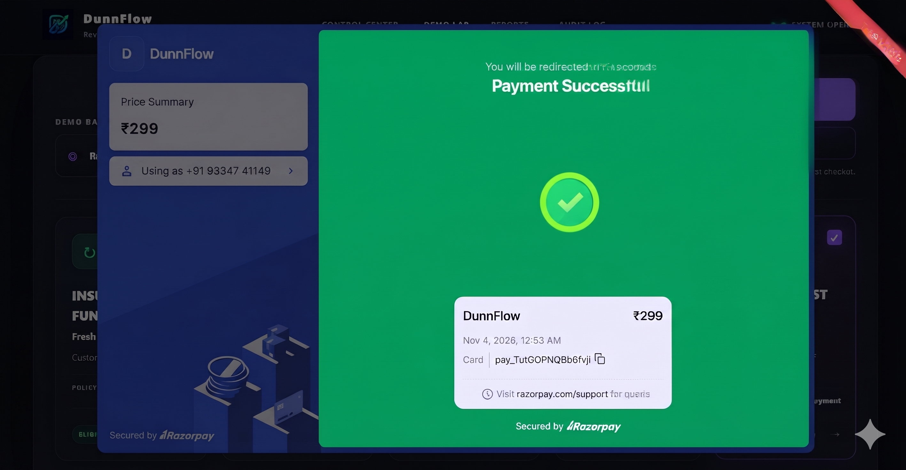
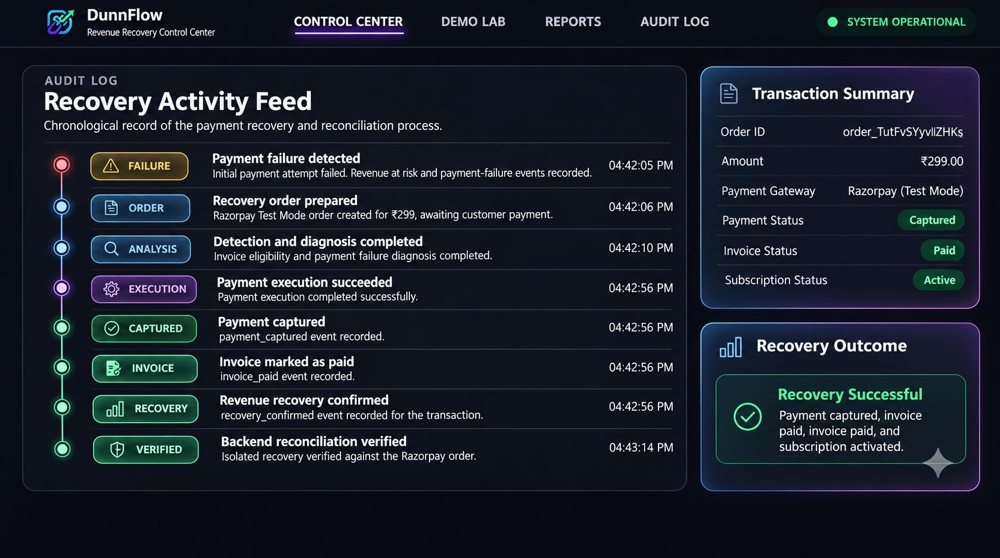

<p align="center">

</p>
::: {align="center"}
# ⚡ DunnFlow

### AI-Assisted Subscription Revenue Recovery Framework

**Detect payment failures. Diagnose the cause. Recommend safe recovery
actions. Execute only within deterministic guardrails. Verify the
financial outcome.**

DunnFlow is an AI-assisted subscription payment recovery system designed
to help identify at-risk recurring revenue and coordinate bounded
recovery workflows. It combines deterministic recovery policies, an
advisory AI layer, scheduled actions, guarded payment execution,
Razorpay Test Mode integration, webhook reconciliation, and an auditable
outcome-tracking layer.

<br/>


<br/>

[Overview](#-overview) • [Architecture](#️-system-architecture) •
[Evaluation](#-evaluation) • [Installation](#️-installation) •
[API](#-api-reference) • [Screenshots](#-screenshots)
:::

------------------------------------------------------------------------

# 📸 Project Preview

<p align="center">

</p>
<p align="center">
<em>DunnFlow --- Revenue Recovery Control Center`</em>`{=html}
</p>

------------------------------------------------------------------------

# 🚀 Project at a Glance

  -----------------------------------------------------------------------
  Area                                What DunnFlow provides
  ----------------------------------- -----------------------------------
  Revenue-risk detection              Identifies invoices eligible for
                                      recovery workflows

  Failure diagnosis                   Interprets payment failure reasons
                                      and subscription context

  AI assistance                       Produces bounded recovery
                                      recommendations with explanations

  Deterministic authorization         Keeps final recovery authority in
                                      policy-controlled logic

  Recovery scheduling                 Plans retries and customer actions
                                      subject to timing limits

  Guarded execution                   Executes only actions permitted by
                                      the deterministic workflow

  Payment integration                 Supports isolated Razorpay Test
                                      Mode order and payment flows

  Reconciliation                      Uses payment status and webhook
                                      events to reconcile outcomes

  Auditability                        Records decisions, actions, events
                                      and state changes
  -----------------------------------------------------------------------

> \[!IMPORTANT\] **AI is advisory, not financially authoritative.**
> DunnFlow's deterministic policy and guarded execution flow retain
> control over whether a recovery action is allowed. An AI
> recommendation does not independently authorize a payment, mark an
> invoice as paid, or bypass recovery limits.

------------------------------------------------------------------------

# 📚 Table of Contents

-   [Overview](#-overview)
-   [Why DunnFlow](#-why-dunnflow)
-   [Core Features](#-core-features)
-   [System Architecture](#️-system-architecture)
-   [Recovery Pipeline](#-recovery-pipeline)
-   [AI Advisory and Policy
    Reconciliation](#-ai-advisory-and-policy-reconciliation)
-   [Safety and Guardrails](#️-safety-and-guardrails)
-   [Evaluation](#-evaluation)
-   [Razorpay Test Mode Integration](#-razorpay-test-mode-integration)
-   [Auditability](#-auditability)
-   [Technology Stack](#️-technology-stack)
-   [Project Structure](#-project-structure)
-   [Installation](#️-installation)
-   [Environment Configuration](#-environment-configuration)
-   [Run Locally](#-run-locally)
-   [API Reference](#-api-reference)
-   [Screenshots](#-screenshots)
-   [Limitations and Scope](#️-limitations-and-scope)
-   [Roadmap](#️-roadmap)
-   [Contributing](#-contributing)
-   [Security](#️-security)
-   [Author](#-author)

------------------------------------------------------------------------

# 📖 Overview

Subscription businesses depend on recurring payments. A failed renewal
can create involuntary churn, interrupt service, and put expected
revenue at risk. A useful recovery system must do more than retry a
payment: it must understand the failure, select an appropriate next
step, respect customer and payment constraints, and verify the final
outcome.

**DunnFlow** is an AI-assisted revenue recovery framework that
coordinates this process through a modular backend and a browser-based
control center.

The system follows a controlled lifecycle:

1.  Detect invoices that may require recovery.
2.  Diagnose the payment failure using available invoice, subscription,
    and attempt context.
3.  Generate an AI recommendation when the advisory layer is available.
4.  Compare the recommendation with deterministic policy.
5.  Schedule an eligible action.
6.  Execute the action through guarded orchestration.
7.  Reconcile gateway and webhook evidence.
8.  Record the final outcome, revenue event, and audit history.

The goal is to demonstrate a transparent and bounded recovery
workflow---not unrestricted autonomous control over financial
transactions.

------------------------------------------------------------------------

# 💡 Why DunnFlow?

A basic payment retry script often treats every failed payment in the
same way. Real payment failures are different: insufficient funds,
expired cards, temporary bank errors, and uncertain gateway outcomes may
require different responses.

DunnFlow explores a more structured approach:

  -----------------------------------------------------------------------
  Common challenge                    DunnFlow approach
  ----------------------------------- -----------------------------------
  Failed payments are difficult to    Detect and classify invoices at
  prioritize                          risk

  A single retry rule does not fit    Diagnose failure context before
  every failure                       selecting an action

  AI suggestions can be unpredictable Keep AI recommendations advisory
                                      and reconcile them with
                                      deterministic policy

  Repeated retries can frustrate      Enforce retry limits and minimum
  customers                           time intervals

  A gateway response may not be the   Reconcile payment and webhook
  final source of truth               evidence

  Recovery decisions can be difficult Maintain decision and execution
  to explain                          audit records
  -----------------------------------------------------------------------

------------------------------------------------------------------------

# ✨ Core Features

  Recovery intelligence             Reliability and control
  --------------------------------- ------------------------------------
  Invoice risk detection            Deterministic policy authorization
  Payment failure diagnosis         Bounded retry scheduling
  AI recovery recommendations       Guarded execution
  Historical decision context       Razorpay Test Mode integration
  AI-versus-policy comparison       Webhook signature verification
  Recovery outcome classification   Idempotent webhook processing
  Batch-level metrics               Audit logging and revenue events

### Recovery outcomes

DunnFlow tracks recovery outcomes using distinct categories:

-   **Recovered:** recovery has been confirmed.
-   **In progress:** the recovery workflow has not reached a final
    outcome.
-   **Exhausted:** the permitted recovery path has been used without
    recovery.
-   **Blocked:** a policy or guardrail prevented the action.
-   **Manual review:** the case requires human assessment.

------------------------------------------------------------------------

# 🏗️ System Architecture

DunnFlow separates the browser interface, API layer, recovery modules,
AI advisory components, Razorpay integration, and persistent data layer.

<p align="center">

</p>
## Architecture layers

  -----------------------------------------------------------------------
  Layer                               Responsibility
  ----------------------------------- -----------------------------------
  Frontend                            Dashboard, Demo Lab, reports, AI
                                      inspection and audit views

  FastAPI backend                     Exposes application, batch, demo,
                                      metrics and webhook endpoints

  Detection and diagnosis             Identifies at-risk invoices and
                                      interprets failure context

  Decision engine                     Selects the deterministic recovery
                                      action

  AI advisory                         Recommends a bounded action and
                                      provides an explanation

  Policy reconciliation               Compares AI advice with the
                                      deterministic decision

  Scheduler                           Plans eligible actions and enforces
                                      timing constraints

  Execution                           Performs authorized recovery
                                      operations

  Outcome tracker                     Reconciles results and classifies
                                      the final outcome

  Razorpay integration                Creates test orders and retrieves
                                      payment information

  Webhook layer                       Verifies and processes gateway
                                      events

  SQLite data layer                   Persists invoices, subscriptions,
                                      attempts, actions, events and audit
                                      records
  -----------------------------------------------------------------------

------------------------------------------------------------------------

# 🔄 Recovery Pipeline

The recovery workflow is organized as a sequence of controlled stages.


## Pipeline stages

  -----------------------------------------------------------------------
  Stage                   Module                  Responsibility
  ----------------------- ----------------------- -----------------------
  01                      Detection               Finds invoices matching
                                                  recovery eligibility
                                                  conditions

  02                      Diagnosis               Analyzes failure reason
                                                  and
                                                  subscription/payment
                                                  context

  03                      Decision                Selects a permitted
                                                  action using
                                                  deterministic policy

  04                      Scheduling              Plans when an eligible
                                                  recovery action may run

  05                      Execution               Executes the authorized
                                                  action through guarded
                                                  logic

  06                      Verification            Reconciles payment and
                                                  webhook evidence

  07                      Measurement             Updates outcome
                                                  classification, revenue
                                                  events and metrics
  -----------------------------------------------------------------------

### Detection condition

The current detection logic identifies candidate invoices using the
following state condition:

``` python
invoice.status == "issued"
subscription.status == "pending"
```

This is an eligibility condition used by the current implementation; it
should not be interpreted as a universal definition of every
failed-payment state.

------------------------------------------------------------------------

# 🧠 AI Advisory and Policy Reconciliation

DunnFlow includes an AI recovery advisor that can use invoice details,
subscription context, failure information, and historical decision
context to recommend a bounded recovery action.

Supported recommendation categories include:

-   `retry_payment`
-   `auto_retry_same_card`
-   `customer_action`
-   `payment_method_update`
-   `manual_review`
-   `no_action`

The recommendation is then compared with the deterministic policy
decision.

<p align="center">

</p>
## Separation of authority

  Component                       Authority
  ------------------------------- -----------------------------------------
  AI Recovery Advisor             Advisory recommendation and explanation
  Deterministic Decision Engine   Final policy decision
  Scheduler                       Timing and eligibility control
  Guarded Execution Engine        Authorized action execution
  Outcome Tracker                 Reconciled recovery outcome

> \[!NOTE\] AI confidence is not a probability that a payment will
> succeed. It describes the model's recommendation confidence and must
> not be presented as a financial success probability.

The AI layer can be configured with supported provider adapters. If an
AI provider is unavailable, the deterministic recovery workflow remains
the policy authority.

------------------------------------------------------------------------

# 🛡️ Safety and Guardrails

Automated recovery must be bounded. The current deterministic policy
includes limits such as:

  Guardrail                                      Current policy
  -------------------------------------------- ----------------
  Maximum automated recovery retries                          3
  Minimum interval between retries                     24 hours
  Maximum recovery messages                                   2
  Minimum interval between recovery messages           48 hours

The original failed charge is not counted as a DunnFlow recovery retry.

These limits help prevent repeated payment attempts and excessive
customer communication. Manual review remains an available outcome when
automated action is not appropriate.

------------------------------------------------------------------------

# 📊 Evaluation

DunnFlow has been evaluated in two separate environments. The results
below are taken from the supplied dashboard screenshots and should be
interpreted within their respective test contexts.

## 1. Synthetic Test Mode

<p align="center">

</p>
<em>Displayed benchmark batch:
benchmark_60_subscription_failures`</em>`{=html}

  Metric                Displayed result
  ------------------- ------------------
  Total cases                         60
  Recovered cases                     27
  Recovery rate                    45.0%
  Revenue at risk                ₹63,540
  Recovered revenue              ₹27,273
  Guardrail blocks                     4
  Manual review                        6
  In progress                         23

The screenshot also reports 27 endpoint successes and 33 safely skipped
cases. The displayed outcome categories are retained as shown in the
captured dashboard.

## 2. Razorpay Test Mode

<p align="center">

</p>
<em>Displayed batch: razorpay_isolated_test_002`</em>`{=html}

  Metric                Displayed result
  ------------------- ------------------
  Total cases                         13
  Recovered cases                     10
  Recovery rate                    76.9%
  Revenue at risk                   ₹897
  Recovered revenue               ₹2,990
  Guardrail blocks                     0
  Manual review                        0
  In progress                          3

These are Razorpay **Test Mode** results, not live production revenue.
The dashboard values are reported as displayed; the recovered-revenue
amount should not be interpreted as a percentage of the displayed
revenue-at-risk amount without checking the underlying metric
definitions and aggregation logic.

## 3. Successful Razorpay payment evidence

<p align="center">

</p>
The supplied checkout screenshot shows a successful ₹299 Razorpay Test
Mode payment. The audit and reconciliation views provide additional
evidence of the application recording payment capture, invoice payment,
subscription activation, and recovery confirmation.

> \[!WARNING\] Before publishing this screenshot publicly, redact the
> visible phone number and payment identifier. Never publish API keys,
> secrets, customer details, or other sensitive payment information.

### Understanding the two evaluations

-   **Synthetic Test Mode** evaluates recovery behavior against a
    controlled benchmark dataset.
-   **Razorpay Test Mode** exercises the payment gateway integration in
    a test environment.
-   Neither result establishes production payment performance or live
    customer revenue recovery.

------------------------------------------------------------------------

# 🧾 Auditability

Recovery automation needs an explainable history. DunnFlow maintains
audit records for important decisions, policy checks, execution steps,
webhook events, and state changes.

<p align="center">

</p>
The audit view is intended to help reviewers follow the recovery
lifecycle, including:

-   Initial payment failure detection.
-   Recovery order preparation.
-   Detection and diagnosis.
-   Authorized execution.
-   Payment capture.
-   Invoice and subscription state changes.
-   Recovery confirmation.
-   Backend reconciliation.

The database also stores revenue events and webhook event records to
support outcome verification and idempotent processing.

------------------------------------------------------------------------

# 🛠️ Technology Stack

  -----------------------------------------------------------------------
  Layer                   Technology              Purpose
  ----------------------- ----------------------- -----------------------
  Language                Python                  Backend and recovery
                                                  logic

  API framework           FastAPI                 REST API and webhook
                                                  endpoints

  ASGI server             Uvicorn                 Local application
                                                  server

  Database                SQLite                  Application and
                                                  recovery state

  AI integrations         OpenAI, Gemini,         Advisory
                          OpenRouter, NVIDIA      recommendations
                          adapters                

  Payment gateway         Razorpay Test Mode      Test order and payment
                                                  integration

  Webhook security        HMAC-SHA256             Signature validation
                          verification            

  Frontend                HTML, CSS, JavaScript   Browser-based control
                                                  center

  Testing                 Pytest and verification Functional and
                          scripts                 integration checks

  Version control         Git and GitHub          Source control
  -----------------------------------------------------------------------

------------------------------------------------------------------------

# 📂 Project Structure

The repository is organized around the API, agent, AI, integration,
recovery-module, persistence, and frontend layers.

``` text
DunnFlow/
│
├── backend/
│   ├── agent/
│   │   └── recovery_agent.py
│   │
│   ├── ai/
│   │   ├── recovery_advisor.py
│   │   ├── ai_policy_reconciliation.py
│   │   └── historical_decision_context.py
│   │
│   ├── data/
│   │   ├── db.py
│   │   └── schema.sql
│   │
│   ├── integrations/
│   │   ├── razorpay_client.py
│   │   ├── razorpay_adapter.py
│   │   └── razorpay_ingestion.py
│   │
│   ├── modules/
│   │   ├── detection.py
│   │   ├── diagnosis.py
│   │   ├── decision_engine.py
│   │   ├── scheduler.py
│   │   ├── execution.py
│   │   ├── outcome_tracker.py
│   │   └── customer_response.py
│   │
│   ├── webhooks/
│   │   ├── handler.py
│   │   └── verifier.py
│   │
│   ├── verification/
│   └── api.py
│
├── static/
│   ├── css/
│   └── js/
│
├── templates/
│   └── index.html
│
├── screenshots/
│
├── main.py
├── requirements.txt
├── .gitignore
└── README.md
```

*This is a high-level map of the principal components; it is not an
exhaustive listing of every repository file.*

------------------------------------------------------------------------

# ⚙️ Installation

## Prerequisites

  Software              Requirement
  --------------------- -------------------------------------------
  Python                3.10 or later
  Git                   Installed
  pip                   Available
  Razorpay account      Test Mode credentials for gateway testing
  AI provider account   Optional; only if enabling an AI provider

## 1. Clone the repository

``` bash
git clone https://github.com/Anujku007/DunnFlow.git
cd DunnFlow
```

## 2. Create a virtual environment

**Windows PowerShell**

``` powershell
python -m venv .venv
.\.venv\Scripts\Activate.ps1
```

**Linux / macOS**

``` bash
python -m venv .venv
source .venv/bin/activate
```

## 3. Install dependencies

The repository's dependency manifest may not include every optional
integration used by the application. Install the dependencies required
by the modules you intend to run.

A baseline installation used during project setup is:

``` bash
python -m pip install --upgrade pip
pip install fastapi "uvicorn[standard]" requests python-dotenv openai google-genai reportlab pytest
```

If your checked-out branch has an updated `requirements.txt`, review it
and install from that file as well:

``` bash
pip install -r requirements.txt
```

------------------------------------------------------------------------

# 🔐 Environment Configuration

Create a `.env` file in the project root. Add only the credentials for
the integrations you intend to use.

``` env
# Application AI configuration
DUNNFLOW_AI_ENABLED=true
DUNNFLOW_AI_PROVIDER=openai
DUNNFLOW_AI_MODEL=
DUNNFLOW_AI_TIMEOUT_SECONDS=30

# AI provider keys (configure the provider you use)
OPENAI_API_KEY=
GEMINI_API_KEY=
OPENROUTER_API_KEY=
NVIDIA_API_KEY=

# Database
DUNNFLOW_DB_PATH=dunnflow.db

# Execution mode
DUNNFLOW_EXECUTION_MODE=synthetic_test_mode

# Razorpay Test Mode
RAZORPAY_MODE=test
RAZORPAY_KEY_ID=
RAZORPAY_KEY_SECRET=
RAZORPAY_WEBHOOK_SECRET=
```

### Configuration notes

-   `DUNNFLOW_AI_PROVIDER` selects the configured AI provider adapter.
-   `DUNNFLOW_AI_MODEL` selects the model used by that provider.
-   `DUNNFLOW_AI_ENABLED` controls whether AI recommendations are
    enabled.
-   `DUNNFLOW_DB_PATH` can be used to set the SQLite database path.
-   `DUNNFLOW_EXECUTION_MODE` selects the execution mode. The default is
    `synthetic_test_mode`; Razorpay Test Mode is configured separately.
-   Keep Razorpay credentials in Test Mode while developing and
    validating the integration.

> \[!CAUTION\] Never commit `.env`, API keys, webhook secrets, database
> files containing private data, or customer payment information to a
> public repository.

------------------------------------------------------------------------

# ▶️ Run Locally

Start the FastAPI application from the repository root:

``` bash
python -m uvicorn backend.api:app --host 127.0.0.1 --port 8080
```

Open the application:

  Service                   Local URL
  ------------------------- ----------------------------------
  DunnFlow Control Center   http://127.0.0.1:8080
  API health                http://127.0.0.1:8080/api/health
  Swagger UI                http://127.0.0.1:8080/docs

If your local branch uses a different entry point, follow the launch
command defined by that branch.

------------------------------------------------------------------------

# 📡 API Reference

The following table summarizes the principal API routes implemented in
the project.

  ----------------------------------------------------------------------------------------
  Method                  Endpoint                                 Purpose
  ----------------------- ---------------------------------------- -----------------------
  GET                     `/api/health`                            Application health
                                                                   check

  GET                     `/api/audit`                             Retrieve audit records

  GET                     `/api/batches/{batch_id}`                Retrieve batch
                                                                   information

  GET                     `/api/batches/{batch_id}/metrics`        Retrieve batch metrics

  GET                     `/api/batches/{batch_id}/agent`          Inspect agent
                                                                   preparation output

  POST                    `/api/batches/{batch_id}/detect`         Run batch detection

  POST                    `/api/batches/{batch_id}/decide`         Run batch decision
                                                                   workflow

  POST                    `/api/batches/{batch_id}/execute`        Execute eligible batch
                                                                   actions

  POST                    `/api/webhooks/razorpay`                 Receive Razorpay
                                                                   webhook events

  POST                    `/api/demo/runs`                         Create a demo run

  GET                     `/api/demo/cases/{invoice_id}`           Inspect a demo invoice
                                                                   case

  POST                    `/api/demo/cases/{invoice_id}/execute`   Execute an eligible
                                                                   demo recovery

  GET                     `/reports/{batch_id}`                    View a batch report
  ----------------------------------------------------------------------------------------

For the current request and response schemas, use the interactive API
documentation at `/docs` while the application is running.

------------------------------------------------------------------------

# 🧪 Verification

The repository includes verification scripts for checking application
behavior and integration flows.

Run the relevant checks from the project root. For example:

``` bash
pytest
```

A Razorpay verification script is also available in the backend
verification directory:

``` bash
python .\backend\verification\final_razorpay_e2e_verification.py
```

Review the script and its output before running it. Verification scripts
can differ in whether they are read-only or perform test actions; use
the appropriate test environment and inspect the code first.

------------------------------------------------------------------------

# 🖼️ Screenshots

The following screenshots are included in this README in the agreed
order:

  -----------------------------------------------------------------------------------------------
  No.                     Screenshot              File
  ----------------------- ----------------------- -----------------------------------------------
  01                      Main Dashboard          `screenshots/01-dashboard.png`

  02                      System Architecture     `screenshots/02-system-architecture.png`

  03                      Synthetic Test Mode     `screenshots/03-synthetic-metrics.png`
                          Metrics                 

  04                      Razorpay Test Mode      `screenshots/04-razorpay-metrics.png`
                          Metrics                 

  05                      Razorpay Payment        `screenshots/05-razorpay-payment-success.png`
                          Success                 

  06                      AI Inspection           `screenshots/06-ai-inspection.png`

  07                      Audit                   `screenshots/07-audit.png`
  -----------------------------------------------------------------------------------------------

------------------------------------------------------------------------

# ⚠️ Limitations and Scope

DunnFlow is a research and engineering prototype demonstrating an
AI-assisted, policy-governed revenue recovery workflow.

-   Razorpay results shown here are from Test Mode, not live production
    payments.
-   Synthetic benchmark results are controlled evaluation results and
    should not be generalized to production populations.
-   AI output depends on the configured provider, model availability,
    and supplied context.
-   AI recommendations remain advisory; deterministic policy is the
    financial authority.
-   Payment-state reconciliation depends on gateway responses, webhook
    delivery, signature verification, and local event processing.
-   Production deployment would require additional operational,
    security, compliance, monitoring, and reliability validation.

------------------------------------------------------------------------

# 🗺️ Roadmap

-   [x] Modular recovery workflow
-   [x] Invoice detection and payment diagnosis
-   [x] Deterministic recovery decision engine
-   [x] AI recovery advisor integration
-   [x] AI-policy reconciliation
-   [x] Guarded execution and scheduling
-   [x] Recovery outcome tracking
-   [x] Razorpay Test Mode order/payment integration
-   [x] Webhook signature verification and event handling
-   [x] Audit and revenue event tracking
-   [ ] Broader automated test coverage
-   [ ] Production-grade observability and alerting
-   [ ] More extensive multi-provider gateway testing
-   [ ] Deployment hardening and operational review

------------------------------------------------------------------------

# 🤝 Contributing

Contributions, bug reports, and suggestions are welcome.

1.  Fork the repository.
2.  Create a feature branch.
3.  Make a focused change.
4.  Add or update tests where appropriate.
5.  Open a pull request with a clear description.

``` bash
git checkout -b feature/your-feature
git add .
git commit -m "Describe your change"
git push origin feature/your-feature
```

------------------------------------------------------------------------

# 🔒 Security

Please do not disclose security vulnerabilities publicly in an issue.

-   Never commit secrets or credentials.
-   Use Razorpay Test Mode for development.
-   Keep webhook signature verification enabled.
-   Avoid sharing unredacted payment screenshots, phone numbers, payment
    IDs, or customer data.
-   Review changes to payment execution and authorization logic
    carefully.

------------------------------------------------------------------------

# 📄 License

No license file was present in the repository at the time this README
was prepared. Until a license is added, do not assume that the project
is licensed for unrestricted reuse, modification, or redistribution.

------------------------------------------------------------------------

::: {align="center"}
# 👨‍💻 Author

### Anuj Kumar

**Machine Learning • Backend Engineering • AI Systems**

[](https://github.com/Anujku007)

[GitHub Repository](https://github.com/Anujku007/DunnFlow)

------------------------------------------------------------------------

### ⭐ Support the Project

If DunnFlow is useful or interesting, consider giving the repository a
star.


:::
