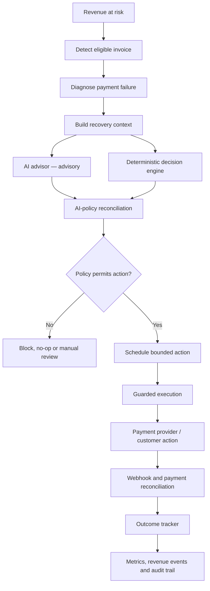

::: {align="center"}
``{=html}

# DunnFlow

### Recover Revenue. Intelligently.

**An AI-assisted, guardrail-driven subscription revenue recovery
platform.**

[](https://www.python.org/)
[](https://fastapi.tiangolo.com/)
[](https://sqlite.org/)
[](https://razorpay.com/)
[](#ai-advisory-layer)

[Architecture](#how-it-works) · [Getting started](#getting-started) ·
[API](#api-overview) · [Evaluation](#evaluation)
:::

------------------------------------------------------------------------

## The problem

A failed subscription payment is not necessarily lost revenue. It may
result from insufficient funds, a bank timeout, an expired card, or an
authentication issue. Treating every failure identically can create
unnecessary retries, frustrate customers, and increase operational risk.

DunnFlow is designed to make recovery more deliberate: understand why a
payment failed, select a bounded response, enforce policy limits, and
verify whether revenue was actually recovered.

## What is DunnFlow?

**DunnFlow is an AI-assisted subscription revenue recovery system** that
coordinates the lifecycle from revenue-at-risk detection to verified
payment outcome.

It combines failure-aware diagnosis, multi-provider AI recommendations,
deterministic decision-making, bounded scheduling and execution,
Razorpay integration, outcome reconciliation, metrics, and an audit
trail.

> \[!IMPORTANT\] **AI advises. Deterministic policy decides. Guarded
> execution acts. Verified payment events establish financial
> outcomes.**
>
> AI recommendations cannot authorize a payment, bypass a guardrail, or
> independently modify financial state.

## Why DunnFlow?

  -----------------------------------------------------------------------
  Common failure-handling approach    DunnFlow approach
  ----------------------------------- -----------------------------------
  Apply identical retries to          Diagnose the failure category first
  different failures                  

  Treat an AI suggestion as an        Keep AI advisory and policy
  instruction                         authoritative

  Retry without clear limits          Enforce retry budgets and minimum
                                      intervals

  Count attempted retries as          Measure reconciled recovery
  recovered revenue                   outcomes

  Make decisions difficult to explain Record decisions, guardrails, and
                                      outcomes
  -----------------------------------------------------------------------

## Core capabilities

```{=html}
<details open>
```
```{=html}
<summary>
```
`<strong>`{=html}Failure detection and diagnosis`</strong>`{=html}
```{=html}
</summary>
```
Detect eligible invoices and classify failure information into
categories such as insufficient funds, bank timeout, authentication
failure, expired card, and unclassified failure. Unknown errors are
handled conservatively.
```{=html}
</details>
```
```{=html}
<details>
```
```{=html}
<summary>
```
`<strong>`{=html}Multi-provider AI recovery advisor`</strong>`{=html}
```{=html}
</summary>
```
Provider adapters are implemented for OpenAI, Google Gemini, OpenRouter,
and NVIDIA. The advisor produces structured recommendations containing
an action, urgency, priority, confidence, reason, and customer strategy.
Recommendations are validated and reconciled against deterministic
policy.
```{=html}
</details>
```
```{=html}
<details>
```
```{=html}
<summary>
```
`<strong>`{=html}Deterministic policy and guardrails`</strong>`{=html}
```{=html}
</summary>
```
  Policy limit                                   Current implementation
  -------------------------------------------- ------------------------
  Maximum automated payment recovery retries                          3
  Minimum interval between payment retries                     24 hours
  Maximum recovery messages                                           2
  Minimum interval between recovery messages                   48 hours

The original failed subscription charge is distinguished from subsequent
DunnFlow recovery attempts. The decision engine decides; it does not
itself execute payments.
```{=html}
</details>
```
```{=html}
<details>
```
```{=html}
<summary>
```
`<strong>`{=html}Scheduling and guarded execution`</strong>`{=html}
```{=html}
</summary>
```
Actions are scheduled and passed through the execution layer. The code
supports synthetic test execution and a Razorpay Test Mode path. Demo
execution uses a virtual clock based on the stored schedule without
rewriting the persisted schedule.
```{=html}
</details>
```
```{=html}
<details>
```
```{=html}
<summary>
```
`<strong>`{=html}Razorpay integration and webhook
reconciliation`</strong>`{=html}
```{=html}
</summary>
```
A dedicated client isolates Razorpay communication from business
modules. The integration includes order creation, payment retrieval,
response normalization, invoice/order/payment correlation, webhook
signature verification, duplicate-event protection, and payment-state
reconciliation.
```{=html}
</details>
```
```{=html}
<details>
```
```{=html}
<summary>
```
`<strong>`{=html}Outcome measurement and auditability`</strong>`{=html}
```{=html}
</summary>
```
DunnFlow tracks recovered, in-progress, exhausted, blocked, and
manual-review outcomes. Payment attempts, recovery actions, revenue
events, and audit entries are stored separately. An attempted
intervention is not automatically counted as recovered revenue;
confirmed recovery is represented through reconciled financial events.
```{=html}
</details>
```
```{=html}
<details>
```
```{=html}
<summary>
```
`<strong>`{=html}Dashboard and reporting`</strong>`{=html}
```{=html}
</summary>
```
The frontend includes the main dashboard, demo workflows, metrics, live
activity feed, audit trail, batch reports, and a standalone AI
inspection page.
```{=html}
</details>
```
## How it works



### Authority boundaries

-   **AI advisor:** provides a recommendation only.
-   **Deterministic decision engine:** selects the authoritative action
    and enforces guardrails.
-   **Scheduler and execution engine:** process permitted actions.
-   **Webhook and outcome tracker:** reconcile payment state and record
    financial outcomes.

The AI layer can agree or disagree with deterministic policy. A
disagreement does not replace the policy decision.

## Safety by design

-   AI does not create payment attempts, execute Razorpay payments, mark
    invoices paid, or bypass decision-engine guardrails.
-   Deterministic policy remains the financial authority.
-   Retry and customer-message limits are checked before actions.
-   Webhook signatures are verified against the raw request body using
    HMAC-SHA256.
-   Webhook event IDs are tracked to protect against duplicate delivery.
-   Attempted actions and confirmed recoveries are represented
    separately.
-   Scoped audit endpoints expose decision and recovery history.

> \[!WARNING\] This is a development and evaluation project, not a
> production-certified payment system. The presence of a Razorpay
> Live-mode configuration option does not establish production
> readiness. Use Razorpay Test Mode for evaluation. Never commit payment
> credentials, API keys, webhook secrets, or customer data.

## Evaluation

### Recorded 60-invoice benchmark

  Metric                      Recorded result
  ------------------------- -----------------
  Invoices evaluated                       60
  Recovered invoices                       29
  Revenue at risk                     ₹63,540
  Recovered value                     ₹31,471
  Recovered invoice share               48.3%
  Value recovery ratio                  49.5%

Calculations: 29 / 60 = 48.3%; ₹31,471 / ₹63,540 = 49.5%. These are
recorded project benchmark results, not production customer outcomes or
a guarantee of future performance.

### Razorpay Test Mode verification

`backend/verification/final_razorpay_e2e_verification.py` checks
existing evidence for order/payment correlation, captured payment,
invoice-paid state, subscription activation, revenue events, audit
records, batch metrics, and webhook security/idempotency boundaries.

The verifier describes itself as read-only: it does not create orders,
execute payments, replay webhooks, or mutate benchmark data. It requires
relevant local database evidence to exist.

> \[!NOTE\] Synthetic benchmark results, automated tests, live
> AI-provider tests, and Razorpay Test Mode checks are different forms
> of evidence. Passing an integration verifier does not establish
> production-scale reliability or a guaranteed recovery rate.

## Technology stack

  Layer             Technology
  ----------------- -------------------------------------------
  Backend API       Python, FastAPI
  ASGI server       Uvicorn
  AI providers      OpenAI, Google Gemini, OpenRouter, NVIDIA
  Payment gateway   Razorpay API and webhooks
  Persistence       SQLite
  Frontend          HTML, CSS, vanilla JavaScript
  PDF reporting     ReportLab
  Testing           pytest and project verification scripts

## Project structure

``` text
DunnFlow/
├── backend/
│   ├── agent/
│   │   └── recovery_agent.py
│   ├── ai/
│   │   ├── recovery_advisor.py
│   │   ├── recovery_context.py
│   │   ├── historical_decision_context.py
│   │   └── ai_policy_reconciliation.py
│   ├── data/
│   │   ├── db.py
│   │   ├── schema.sql
│   │   ├── seed_data.py
│   │   ├── demo_runs.py
│   │   └── razorpay_demo.py
│   ├── integrations/
│   │   ├── razorpay_client.py
│   │   ├── razorpay_adapter.py
│   │   └── razorpay_ingestion.py
│   ├── modules/
│   │   ├── detection.py
│   │   ├── diagnosis.py
│   │   ├── decision_engine.py
│   │   ├── scheduler.py
│   │   ├── execution.py
│   │   ├── customer_response.py
│   │   ├── outcome_tracker.py
│   │   └── report.py
│   ├── verification/
│   ├── webhooks/
│   │   ├── handler.py
│   │   └── verifier.py
│   ├── api.py
│   └── main.py
├── static/
│   ├── css/
│   ├── images/
│   └── js/
├── templates/
├── reports/
├── orchestrator.py
├── requirements.txt
└── README.md
```

## Getting started

### Prerequisites

-   Python 3.10 or later.
-   Git.
-   Optional: API credentials for one supported AI provider.
-   Optional: Razorpay Test Mode API credentials for payment integration
    testing.

### 1. Clone the repository

``` bash
git clone https://github.com/Anujku007/DunnFlow.git
cd DunnFlow
```

### 2. Create a virtual environment

**Windows PowerShell**

``` powershell
python -m venv .venv
.\.venv\Scripts\Activate.ps1
```

**macOS / Linux**

``` bash
python3 -m venv .venv
source .venv/bin/activate
```

### 3. Install dependencies

The repository's current `requirements.txt` does not yet list every
runtime dependency imported by the application. Until the dependency
manifest is consolidated, install the required packages explicitly:

``` bash
python -m pip install --upgrade pip
python -m pip install fastapi "uvicorn[standard]" requests python-dotenv openai google-genai reportlab pytest
```

Verify a clean installation after changing dependencies.

### 4. Configure environment variables

Create a `.env` file in the repository root. Do not commit it.

``` dotenv
# Application
DUNNFLOW_DB_PATH=dunnflow.db
DUNNFLOW_EXECUTION_MODE=synthetic_test_mode

# AI
DUNNFLOW_AI_ENABLED=true
DUNNFLOW_AI_PROVIDER=nvidia
DUNNFLOW_AI_MODEL=nvidia/nemotron-3.5-super-vl-120b-a12b
DUNNFLOW_AI_TIMEOUT_SECONDS=30

# Add the key for the selected provider
NVIDIA_API_KEY=

# Alternative provider keys (only if using that provider)
# OPENAI_API_KEY=
# GEMINI_API_KEY=
# OPENROUTER_API_KEY=

# Razorpay — use Test Mode credentials for development
RAZORPAY_MODE=test
RAZORPAY_KEY_ID=
RAZORPAY_KEY_SECRET=
RAZORPAY_WEBHOOK_SECRET=
```

**Provider-to-key mapping**

  `DUNNFLOW_AI_PROVIDER`   Environment variable
  ------------------------ ----------------------
  `openai`                 `OPENAI_API_KEY`
  `gemini`                 `GEMINI_API_KEY`
  `openrouter`             `OPENROUTER_API_KEY`
  `nvidia`                 `NVIDIA_API_KEY`

The selected AI provider and model are read when the application process
initializes. Restart the API server after changing provider environment
variables.

Use Razorpay Test Mode credentials and the matching Test Mode webhook
secret. Never place credentials in frontend JavaScript or commit them to
source control.

### 5. Run the application

``` bash
python -m uvicorn backend.api:app --host 127.0.0.1 --port 8080
```

Open the following URLs:

-   Dashboard: <http://127.0.0.1:8080/>
-   AI inspection: <http://127.0.0.1:8080/ai-inspection>
-   Health check: <http://127.0.0.1:8080/api/health>
-   Interactive API docs: <http://127.0.0.1:8080/docs>

The application initializes the SQLite schema on startup. By default,
the database is `dunnflow.db` in the repository root. `DUNNFLOW_DB_PATH`
can override its location.

## Razorpay Test Mode setup

1.  Enable Test Mode in your Razorpay account.

2.  Generate Test Mode API credentials.

3.  Set `RAZORPAY_MODE=test`, `RAZORPAY_KEY_ID`, and
    `RAZORPAY_KEY_SECRET` in `.env`.

4.  Configure a webhook endpoint pointing to your reachable development
    server, for example:

    ``` text
    https://<your-tunnel-host>/api/webhooks/razorpay
    ```

5.  Set `RAZORPAY_WEBHOOK_SECRET` to the matching webhook secret.

6.  Subscribe to the payment events used by your configured flow,
    including `payment.authorized`, `payment.captured`, and `order.paid`
    where applicable.

7.  Verify delivery and reconciliation using the project's verification
    scripts.

A secure tunnel can expose a local webhook endpoint during development.
Keep tunnel URLs and secrets out of source control.

## API overview

The interactive `/docs` page is the authoritative request/response
reference.

  ---------------------------------------------------------------------------------------------------
  Method                  Endpoint                                            Purpose
  ----------------------- --------------------------------------------------- -----------------------
  `GET`                   `/api/health`                                       Service health

  `POST`                  `/api/webhooks/razorpay`                            Verify and process
                                                                              Razorpay webhooks

  `POST`                  `/api/demo/runs`                                    Create an isolated
                                                                              synthetic demo run

  `GET`                   `/api/demo/runs/{run_id}`                           Inspect demo-run
                                                                              metadata

  `GET`                   `/api/audit`                                        Read scoped
                                                                              audit/timeline events

  `GET`                   `/api/batches/{batch_id}`                           Retrieve batch
                                                                              information

  `POST`                  `/api/batches/{batch_id}/detect`                    Detect revenue at risk

  `POST`                  `/api/batches/{batch_id}/decide`                    Generate deterministic
                                                                              decisions

  `POST`                  `/api/batches/{batch_id}/execute`                   Execute due batch
                                                                              actions

  `GET`                   `/api/batches/{batch_id}/metrics`                   Retrieve batch metrics

  `GET`                   `/api/batches/{batch_id}/agent`                     Inspect agent result

  `GET`                   `/api/demo/cases/{invoice_id}`                      Inspect a demo invoice

  `GET`                   `/api/demo/cases/{invoice_id}/inspect`              Read-only AI and policy
                                                                              inspection

  `POST`                  `/api/demo/cases/{invoice_id}/decide`               Persist a demo decision

  `POST`                  `/api/demo/cases/{invoice_id}/execute`              Execute a planned demo
                                                                              action

  `POST`                  `/api/demo/razorpay/session`                        Create an isolated
                                                                              Razorpay demo session

  `GET`                   `/api/demo/razorpay/session/{session_id}`           Inspect Razorpay demo
                                                                              session

  `POST`                  `/api/demo/razorpay/session/{session_id}/recover`   Start demo recovery

  `GET`                   `/api/demo/razorpay/inspect/{invoice_id}`           Inspect a Razorpay demo
                                                                              invoice

  `GET`                   `/api/demo/razorpay/metrics`                        Isolated Razorpay demo
                                                                              metrics

  `GET`                   `/api/batches/{batch_id}/razorpay-checkout`         Retrieve checkout
                                                                              information

  `GET`                   `/reports/{batch_id}`                               View a batch report

  `GET`                   `/api/batches/{batch_id}/report`                    Download a batch report
  ---------------------------------------------------------------------------------------------------

> \[!CAUTION\] Some `POST` endpoints persist decisions or execute
> recovery actions. Read their behavior before calling them. Use
> isolated demo data and synthetic execution mode while learning the
> workflow. Do not test execution against live customer payments.

### Read-only inspection example

The isolated demo inspection endpoint requires a `run_id` query
parameter:

``` http
GET /api/demo/cases/{invoice_id}/inspect?run_id={run_id}
```

It returns invoice and diagnosis information, the deterministic
decision, AI-policy reconciliation, and historical context. It is
intended as a read-only inspection path.

## Testing and verification

Run scripts from the repository root with the virtual environment
activated.

**AI policy hardening**

``` bash
python backend/verification/verify_ai_hardening.py
```

**NVIDIA provider connectivity and structured recommendation**

``` bash
python backend/verification/test_live_nvidia.py
```

This test makes a live request to NVIDIA. It requires a valid key,
network access, and available provider quota.

**NVIDIA scenario evaluation**

``` bash
python backend/verification/test_nvidia_scenarios.py
```

**AI-policy reconciliation**

``` bash
python backend/verification/test_live_ai_reconciliation.py
```

**Razorpay end-to-end evidence verification**

``` bash
python backend/verification/final_razorpay_e2e_verification.py
```

The Razorpay verifier checks existing local evidence. It expects
relevant database records and prior Test Mode activity to exist; it does
not create orders, initiate payments, replay webhooks, or mutate
benchmark data.

Additional focused tests are located under `backend/ai/` and
`backend/data/`. Review their setup and side effects before running them
against a database containing data you care about.

## Data model

The SQLite schema in `backend/data/schema.sql` defines these core
tables:

  -----------------------------------------------------------------------
  Table                               Responsibility
  ----------------------------------- -----------------------------------
  `batch_runs`                        Batch execution and metrics

  `subscriptions`                     Subscription lifecycle and
                                      customer/plan context

  `invoices`                          Revenue obligations and payment
                                      state

  `payment_attempts`                  Initial and recovery payment
                                      attempts

  `recovery_actions`                  Planned, executed, blocked, or
                                      cancelled actions

  `revenue_events`                    Revenue-at-risk and recovery
                                      evidence

  `audit_log`                         Explainability and operational
                                      history

  `razorpay_webhook_events`           Webhook event idempotency
  -----------------------------------------------------------------------

Amounts are stored in the smallest currency unit (paise for INR). For
example, ₹299.00 is stored as `29900`.

## Roadmap

These are potential next steps, not claims that they are already
implemented:

-   [ ] Publish a complete dependency manifest and clean-install
    verification.
-   [ ] Add automated CI checks for tests, linting, and type checks.
-   [ ] Add deployment and operational runbooks.
-   [ ] Expand reproducible benchmark reporting across failure
    categories.
-   [ ] Review observability, secrets management, access control, and
    operational recovery for production use.
-   [ ] Add maintained screenshots and a concise demo walkthrough.

## Contributing

Contributions, bug reports, and architecture discussions are welcome.

1.  Fork the repository.
2.  Create a focused feature branch.
3.  Make the change and add tests where appropriate.
4.  Verify that deterministic authority and execution guardrails remain
    intact.
5.  Open a pull request explaining the motivation, implementation, and
    verification performed.

Do not publish credentials, payment identifiers, customer data, or
exploit details in public issues.

## Security

-   Never commit `.env`, API keys, webhook secrets, database files, or
    customer/payment data.
-   Use Razorpay Test Mode for development and demonstrations.
-   Rotate credentials that may have been exposed.
-   Avoid sharing raw production webhook payloads or personal
    information in issue reports.
-   Report security concerns privately to the repository maintainer.

## License

No license file was present in the repository when this README was
prepared. Until a license is added, do not assume the project grants
permission to reuse, distribute, or modify its code. Add an explicit
`LICENSE` file before presenting the repository as open source.

------------------------------------------------------------------------

## Project

**DunnFlow --- AI-assisted subscription revenue recovery**

Built for the Razorpay AI Buildathon, Track 03: AI Revenue Recovery.

-   Repository: <https://github.com/Anujku007/DunnFlow>
-   Backend entry point: `backend/api.py`
-   Main orchestrator: `orchestrator.py`
-   Database schema: `backend/data/schema.sql`

::: {align="center"}
**Detect intelligently. Decide responsibly. Recover measurably.**

`<sub>`{=html}Built with Python, FastAPI, AI provider integrations,
SQLite, and Razorpay Test Mode.`</sub>`{=html}
:::
